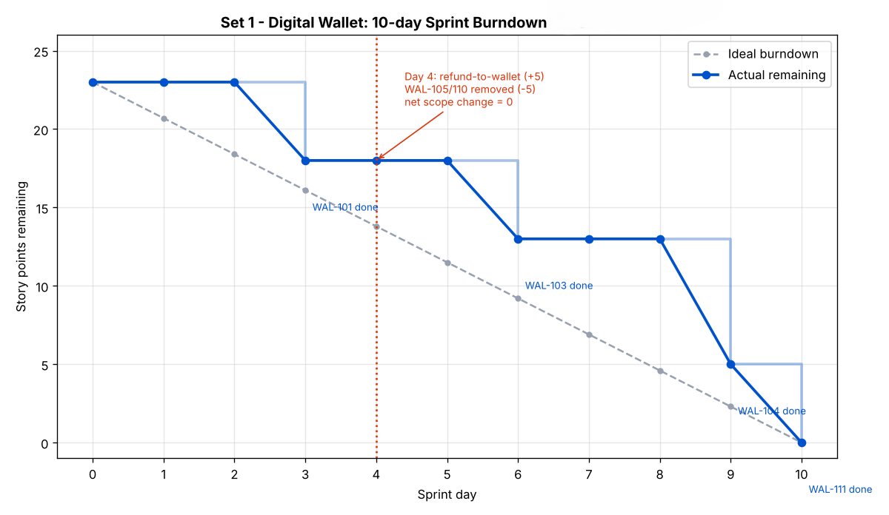

# Set 1 – Task 5: Sprint Burndown (10 days)

> **Data note:** The assignment's "supplied completed-points table" was **not included** in the document provided. The table below is **illustrative**, built to be consistent with Tasks 1–4. Scope = 23 points (WAL-101 5, WAL-103 5, WAL-104 8, WAL-111 5 after the Day 4 swap).

## Completed-points table (illustrative)

| Day | Points completed that day | Scope added | Scope removed | Remaining (actual) | Ideal remaining |
|---|---|---|---|---|---|
| 0 (start) | – | – | – | 23 | 23.0 |
| 1 | 0 | 0 | 0 | 23 | 20.7 |
| 2 | 0 | 0 | 0 | 23 | 18.4 |
| 3 | 5 (WAL-101) | 0 | 0 | 18 | 16.1 |
| 4 | 0 | +5 (WAL-111) | −5 (WAL-105, 110) | 18 | 13.8 |
| 5 | 0 | 0 | 0 | 18 | 11.5 |
| 6 | 5 (WAL-103) | 0 | 0 | 13 | 9.2 |
| 7 | 0 | 0 | 0 | 13 | 6.9 |
| 8 | 0 | 0 | 0 | 13 | 4.6 |
| 9 | 8 (WAL-104) | 0 | 0 | 5 | 2.3 |
| 10 | 5 (WAL-111) | 0 | 0 | 0 | 0.0 |

Calculation: ideal remaining on day *d* = 23 × (10 − d) / 10. Actual remaining = previous remaining − points completed + scope added − scope removed. Points count only when a story meets the Definition of Done.

## Interpretation

1. **Behind the ideal line from Day 3 to Day 9.** The gap peaks on Day 8 (13 actual vs 4.6 ideal, about 8.4 points behind).
2. **Staircase shape.** Points burn in large steps (5, 5, 8, 5) because stories are big and are finished late. Little work is "Done" until the end of the sprint.
3. **Scope change had no net effect.** On Day 4 the line stays flat since +5 and −5 cancel. This shows the swap was handled without growing the sprint.
4. **Back-loaded finish.** All 23 points complete only on Day 10, with 13 points (WAL-104 and WAL-111) landing in the final 2 days. The sprint goal was met, but with high risk: any delay on WAL-104 would have missed it.
5. **Likely causes:** the 8-point WAL-104 was not split; review queue time; test-environment delays (IMP-02).

## Recommendations
- Split stories to ≤ 3 points or 3 days so value burns down daily.
- Limit work in progress; finish before starting.
- Review the burndown at each stand-up; if a flat line lasts three days, discuss at once.
